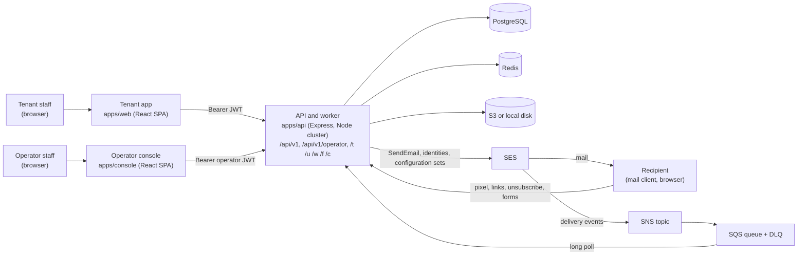
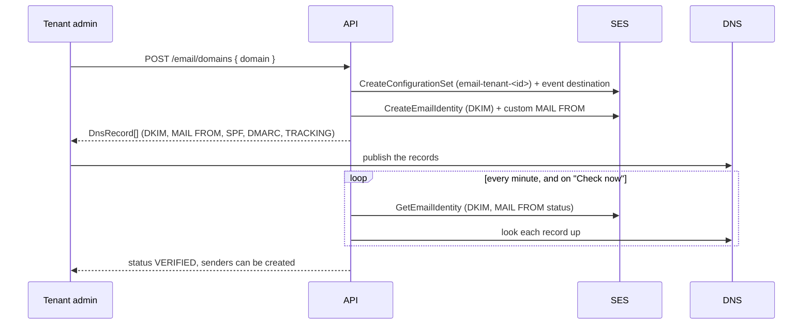
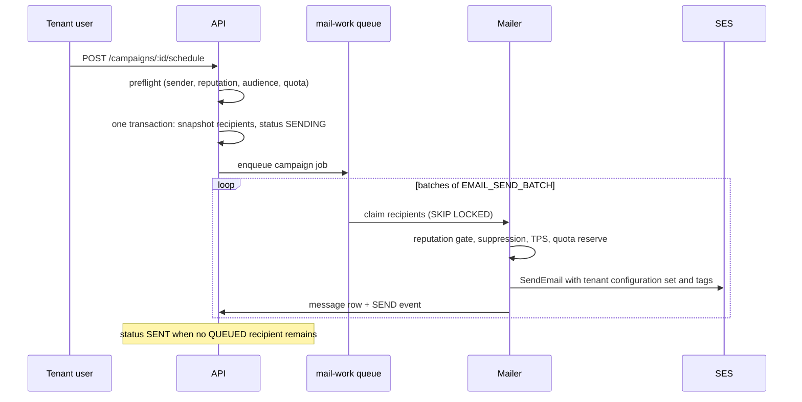
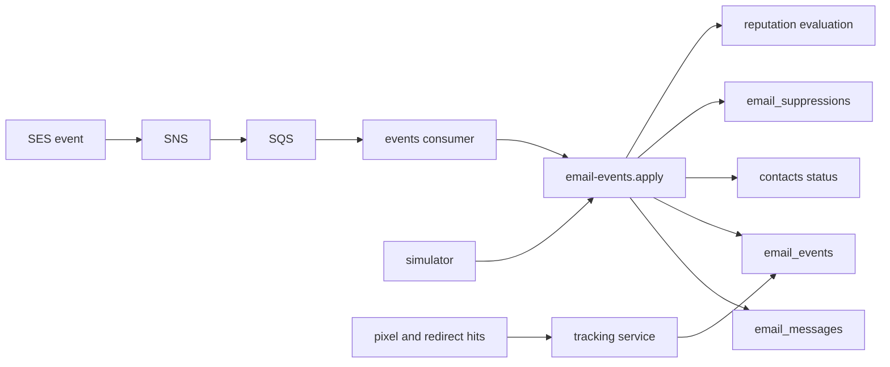
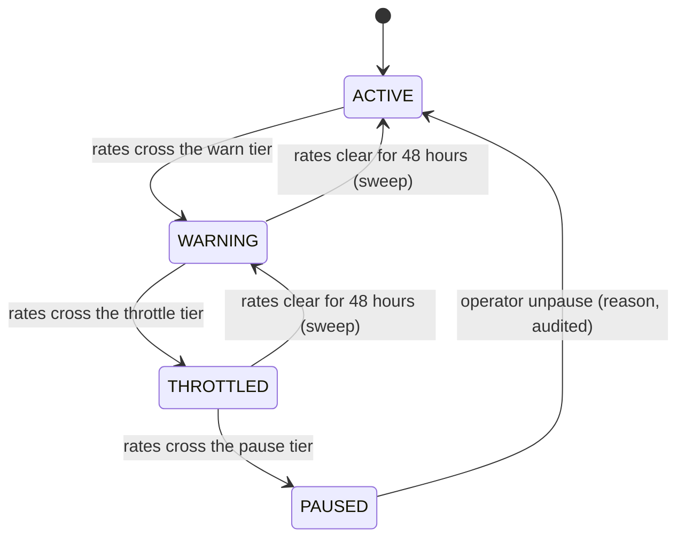
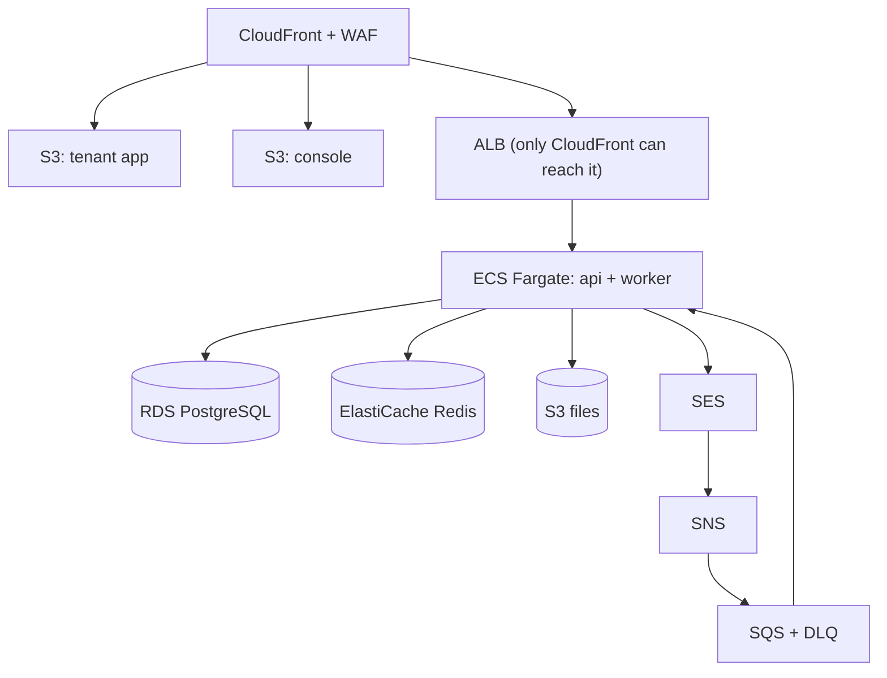

# High-level design

Euron Open Email Engine is a self-hosted alternative to Mailchimp or SendGrid for campaigns, built on
Amazon SES, and multi-tenant so one operator can serve many workspaces (see [comparison.md](comparison.md)). An operator runs one deployment and sells workspaces (tenants) on plans
that carry a monthly send quota. Each tenant verifies its own sending domains with DNS, creates
sender identities, builds an audience (contacts, custom fields, tags, lists, rule-based
segments, CSV import, hosted subscribe forms with optional double opt-in), designs templates,
composes campaigns, sends or schedules them, and reads the result: delivery, bounces,
complaints, opens, clicks, unsubscribes, per-link clicks and sending reputation.

There are no payments, no developer REST send API, no SMTP relay and no outbound webhooks in
0.1 (see [Limitations](#7-limitations) and
[write-an-integration-note](../guides/write-an-integration-note.md)). Everything runs locally
with no AWS account through a simulated provider mode
([ADR 0006](adr/0006-simulated-providers.md)) or against the Floci emulator.

Paths are relative to the repository root.

| Topic | Page |
| --- | --- |
| How it compares to hosted and open-source tools | [comparison.md](comparison.md) |
| Modules, layers, jobs and the request pipeline in code | [LLD.md](LLD.md) |
| Every table, grouped by domain | [data-model.md](data-model.md) |
| Tenants, plans, the entitlement snapshot and the monthly quota | [multi-tenancy-and-entitlements.md](multi-tenancy-and-entitlements.md) |
| Roles, custom roles, per-user overrides, visible modules | [rbac.md](rbac.md) |
| The campaign pipeline from audience snapshot to SES | [sending-pipeline.md](sending-pipeline.md) |
| Open pixel, click redirect, unsubscribe, view in browser | [tracking.md](tracking.md) |
| Contacts, lists, segments, forms, imports | [audience-and-segments.md](audience-and-segments.md) |
| Reputation tiers, the gate before cost, domain health | [deliverability-and-reputation.md](deliverability-and-reputation.md) |
| The simulator and Floci | [simulated-providers.md](simulated-providers.md) |
| Security controls and limitations | [security.md](security.md) |
| STRIDE analysis and residual risks | [threat-model.md](threat-model.md) |
| Decisions and their trade-offs | [adr/](adr/README.md) |
| Every route | [../api/rest-contract.md](../api/rest-contract.md) |

## 1. System context

The three kinds of caller:

- **Tenant staff** use the tenant app. Every request carries a tenant bearer token and the API
  scopes every query to that tenant.
- **Operator staff** use the console, which calls the same API under `/api/v1/operator` with an
  operator token. The operator plane has no tenant scope: it sees the fleet.
- **Recipients** never sign in. The links inside an email (open pixel, click redirect,
  unsubscribe, view in browser, subscribe form, confirmation) are public routes on the API root,
  protected by signed tokens instead of sessions ([tracking.md](tracking.md)).

## 2. What runs

| Process | Code | Does |
| --- | --- | --- |
| API | [`apps/api/src/index.ts`](../../apps/api/src/index.ts), [`apps/api/src/app.ts`](../../apps/api/src/app.ts) | One Node cluster: the primary forks one worker per CPU in production (one in development). Every worker serves HTTP. Exactly one worker is forked with `RUN_JOBS=true` and also runs the background work; if it dies, its replacement keeps that role |
| Background work | [`apps/api/src/jobs`](../../apps/api/src/jobs), [`apps/api/src/queue/work.ts`](../../apps/api/src/queue/work.ts) | Four recurring sweeps in [`registry.ts`](../../apps/api/src/jobs/registry.ts) on a BullMQ job scheduler (an interval fallback without Redis), the `mail-work` queue for campaign sending and CSV imports, and one long-poll SQS consumer for SES delivery events |
| Tenant app | [`apps/web`](../../apps/web) | The tenant SPA (React 19, Vite, TanStack Query, Zustand). Navigation follows the `modules` list the API returns at sign-in |
| Operator console | [`apps/console`](../../apps/console) | The operator SPA: tenants, plans, fleet reputation, SES account health, dead-letter queue, operators, audit |
| Migrations | [`db/migrate.ts`](../../db/migrate.ts) | Forward-only SQL runner with checksums ([ADR 0010](adr/0010-sql-migrations-prisma-types-only.md)) |

The recurring sweeps are `campaign-scheduler` (30 seconds), `verify-domains` (1 minute),
`reputation-recovery` (10 minutes) and `health-sweep` (24 hours).

## 3. The four flows that matter

### Onboard a sending domain

### Send a campaign

### Learn what happened

### Protect the account

## 4. Design choices in one place

| Choice | Why | Where |
| --- | --- | --- |
| One engine on SES with a configuration set per tenant | One AWS account to operate, per-tenant event attribution through message tags | [ADR 0001](adr/0001-one-engine-on-ses.md), [sending-pipeline.md](sending-pipeline.md) |
| Own pixel and redirect tracking | No third party sees recipient behaviour; the click destination is read from the database, never from the token | [ADR 0002](adr/0002-own-tracking.md), [tracking.md](tracking.md) |
| Everything is scoped by `tenant_id` | One schema, one rule, cross-tenant ids are 404 | [ADR 0003](adr/0003-tenant-scoped-everything.md) |
| Entitlements first, plans are quotas | The runtime never reads a plan; a plan is snapshotted into entitlement rows | [ADR 0004](adr/0004-entitlements-first-plans-as-quotas.md) |
| Reputation gate before cost | A bad list is stopped before it can burn the shared SES account | [ADR 0005](adr/0005-reputation-gate-before-cost.md) |
| Simulated providers | The whole product runs and is tested with no AWS account | [ADR 0006](adr/0006-simulated-providers.md) |
| Unsubscribe by POST | A scanner that opens the link cannot unsubscribe anyone | [ADR 0007](adr/0007-unsubscribe-by-post-only.md) |
| Platform tracking host fallback | TLS certificates exist only for platform hosts | [ADR 0008](adr/0008-platform-tracking-host-fallback.md) |
| No developer API in 0.1 | Campaigns first; an API needs keys, scopes and its own rate limits | [ADR 0009](adr/0009-no-developer-api-in-0-1.md) |

## 5. Deployment shape

[deploy-aws.md](../guides/deploy-aws.md) builds this with
[`infra/terraform`](../../infra/terraform). The same modules provision the Floci emulator
locally.

## 6. Where to look when

| Question | Start at |
| --- | --- |
| Why did this campaign pause? | `campaigns.paused_reason`, [deliverability-and-reputation.md](deliverability-and-reputation.md) |
| Why was this contact skipped? | `campaign_recipients.skip_reason`, [sending-pipeline.md](sending-pipeline.md) |
| Why no opens? | [tracking.md](tracking.md), [troubleshooting](../guides/troubleshooting.md#no-opens-are-recorded) |
| Which route does X? | [rest-contract.md](../api/rest-contract.md) |

## 7. Limitations

Stated plainly, so nobody finds them in production:

- **Opens are unreliable.** Apple Mail Privacy Protection and image blocking distort them.
  Machine opens are recorded and flagged, never hidden, and reports say so. Clicks are the
  stronger signal.
- **Tracking links use the platform host** unless `EMAIL_TRACKING_CUSTOM_DOMAINS=true` and a
  certificate for each tenant `track.<domain>` name is in place. The Terraform does not issue
  those certificates.
- **No A/B tests**, no automations or drip sequences, no per-recipient send-time optimisation.
- **No developer API, no SMTP relay, no outbound webhooks** in 0.1. Campaigns only.
- **Imports are bounded**: 10 MB and 100,000 rows per file, one email column.
- **Segments are evaluated at send time**, when the recipients are snapshotted. A contact who
  changes after that is still in the snapshot.
- **No bounce handling for mail the engine did not send.** It reads only the events SES
  publishes for its own configuration sets.
- **One SES account per deployment.** All tenants share its sending quota and its reputation;
  the per-tenant gate protects it ([deliverability-and-reputation.md](deliverability-and-reputation.md)).
- **Bearer tokens are not revocable** before they expire (12 hours by default).
