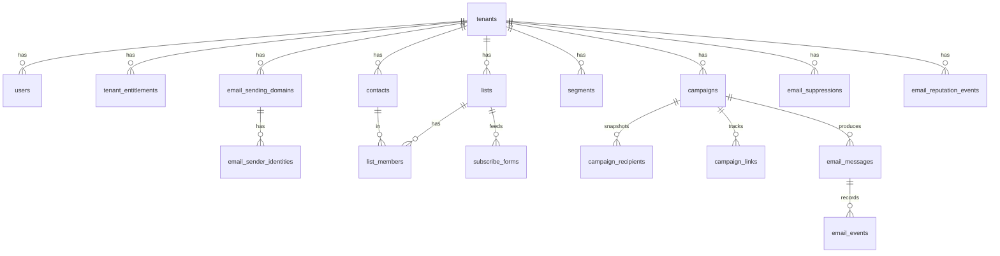

# Data model

Every table, grouped by domain. The source of truth is the single migration
[`db/migrations/0001_init.sql`](../../db/migrations/0001_init.sql); Prisma
([`apps/api/prisma/schema.prisma`](../../apps/api/prisma/schema.prisma)) only describes it so
Kysely types can be generated ([ADR 0010](adr/0010-sql-migrations-prisma-types-only.md)).

## Conventions

- Primary keys are text ULIDs minted by the API (sortable by creation time). `contacts`,
  `campaigns` and the others page by `id` descending, so the cursor is the last id.
- Timestamps are `timestamp(3)` without time zone, always UTC.
- **Every tenant-scoped table has `tenant_id`** with `ON DELETE CASCADE` to `tenants`, and every
  query filters on it ([ADR 0003](adr/0003-tenant-scoped-everything.md)). Deleting a tenant
  removes all of its rows.
- Emails are stored lowercased and a `CHECK (email = lower(email))` enforces it on `contacts`
  and `email_suppressions`.
- Enums are PostgreSQL enums (section "Enums").
- Counts that the database can derive are derived in SQL (reports, dashboard, fleet), not kept
  in counters, except `email_messages.open_count` and `click_count`, `contacts.emails_received`
  and `tenant_usage_monthly.emails_sent`.

## Operator plane

| Table | Holds |
| --- | --- |
| `operator_users` | Platform staff: email (unique), bcrypt hash, role `SUPERADMIN` or `OPERATOR`, status |
| `plans` | A sales artifact: `key` (UPPER_SNAKE), `modules` (JSON array of module keys), `limits` (JSON: `monthlyEmails`, `maxContacts`, `maxDomains`, `maxUsers`; null or missing is unlimited), `is_active`, `sort_order`. Runtime never reads it |
| `operator_audit_logs` | Operator actions: actor, action, category, optional tenant, summary, metadata |

## Tenancy and access

| Table | Holds |
| --- | --- |
| `tenants` | Slug (unique), name, `plan_key`, `brand_color`, `timezone` (display only), `company_address` (campaign footer), `status` (`ACTIVE`, `SUSPENDED`, `CLOSED`), free-form `config` (`emailTps`, an operator-set send rate, is ignored when a tenant writes `config`), and the reputation state: `email_sending_status` and `email_sending_status_changed_at` |
| `tenant_entitlements` | What the tenant may use now: `code` (`module.<key>` or `limit.<name>`), `enabled`, `limit_value` (null is unlimited), `source` (`PLAN` or `ADMIN`). Unique per tenant and code |
| `tenant_usage_monthly` | Emails sent per tenant per UTC month: primary key `(tenant_id, month)`, `emails_sent` |
| `users` | Tenant staff: unique per `(tenant_id, email)`, bcrypt hash, `role` (text), `status`, optional per-user `permissions` override |
| `roles` | Per-tenant role definitions: custom roles and overrides of built-ins (`builtin` true) |
| `audit_logs` | Tenant audit: user, action, entity type and id, meta |
| `notifications` | Per-user in-app notices |
| `files` | Stored uploads (CSV imports): key, bucket, `storage` (`S3` or `LOCAL`), entity link |

## Sending infrastructure

| Table | Holds |
| --- | --- |
| `email_sending_domains` | One row per tenant domain: `subdomain` (unique across tenants, case-insensitive: SES identities are unique per account), `mail_from_subdomain`, `ses_configuration_set`, `status`, `dkim_status`, `mail_from_status`, `dns_records` (JSON `DnsRecord[]`), `tracking_domain` and `tracking_status` (`PENDING` or `VERIFIED`), `failure_reason`, `verified_at`, `last_checked_at` |
| `email_sender_identities` | Sender addresses on a domain: unique per `(tenant_id, lower(email_address))`, display name, reply-to, `status`, and three default flags per category |
| `email_domain_health_checks` | Daily snapshots from the health sweep: DKIM and MAIL FROM status, SPF and DMARC presence, failures |
| `email_reputation_events` | Every sending status change: from, to, trigger (`bounce`, `complaint`, `recovery`, `operator_unpause`), reason, rates snapshot |
| `email_suppressions` | Addresses not to mail: `reason` (`HARD_BOUNCE`, `COMPLAINT`, `UNSUBSCRIBE`, `ADMIN_BLOCK`, `IMPORTED`) and `category_scope` (null means every category). Uniqueness is two partial indexes because PostgreSQL treats nulls as distinct |

## Audience

| Table | Holds |
| --- | --- |
| `contacts` | Unique per `(tenant_id, email)`. First and last name, `status` (`SUBSCRIBED`, `UNSUBSCRIBED`, `BOUNCED`, `COMPLAINED`, `PENDING_CONFIRMATION`), `source` (`MANUAL`, `IMPORT`, `FORM`, `API`), `tags` (text array, GIN indexed), `attributes` (JSON, keys match custom fields), `last_opened_at`, `last_clicked_at`, `emails_received`, `consent_at`, `consent_ip_hash`, `unsubscribed_at` |
| `custom_fields` | Declared attribute keys and types (`text`, `number`, `date`, `boolean`), unique per tenant and key |
| `lists` | Static lists with a `double_opt_in` flag |
| `list_members` | Primary key `(list_id, contact_id)`, `status` (`subscribed`, `pending`, `unsubscribed`) |
| `segments` | Name and `rules` JSON; `contact_count` is a cached count, null until computed |
| `subscribe_forms` | Hosted form config: globally unique `slug`, target list, copy, `collect_name`, `submissions`, `active` |
| `import_jobs` | CSV import state: `UPLOADED`, `QUEUED`, `PROCESSING`, `DONE`, `FAILED`; column mapping, counts, up to 100 row errors |

## Templates and campaigns

| Table | Holds |
| --- | --- |
| `templates` | Name, subject, preheader, `html`, `text_body`, `is_starter` (starters cannot be deleted) |
| `campaigns` | Status machine, subject, preheader, `html` (a copy: later template edits do not change it), `template_id`, `sender_identity_id`, `audience` JSON (`ALL`, `LISTS`, `SEGMENT`), `scheduled_at`, `started_at`, `completed_at`, `paused_reason`. A partial index serves the scheduler's due scan |
| `campaign_recipients` | The audience snapshot: one row per contact, unique per `(campaign_id, contact_id)`, `status`, `skip_reason`, `message_id`, `claimed_at` for worker claims |
| `campaign_links` | The links found in the campaign HTML: `url` and a short random `token`, unique per campaign. The click redirect reads its destination from here |

## Messages and events

| Table | Holds |
| --- | --- |
| `email_messages` | Every message handed to the provider: category, from, to, subject, `ses_message_id`, `status`, `simulated`, `idempotency_key` (unique per tenant when set), `open_count`, `click_count`, bounce type and reason, and a timestamp per milestone (sent, delivered, bounced, complained, opened, clicked) |
| `email_events` | SEND, DELIVERY, BOUNCE, COMPLAINT, REJECT, OPEN, CLICK, UNSUBSCRIBE with `occurred_at`, `detail`, `url`, `machine`, `ip_hash`, `ua_class`. `campaign_id` and `contact_id` are denormalised so reports never join. A unique partial index on `(message_id, type)` for the once-per-message types makes replayed SES events harmless |

## Enums

`operator_role`, `user_status`, `tenant_status`, `entitlement_source`, `storage_provider`,
`email_domain_status`, `email_identity_status`, `email_category` (`TRANSACTIONAL`,
`NOTIFICATION`, `MARKETING`), `email_message_status`, `email_suppression_reason`,
`email_sending_status` (`ACTIVE`, `WARNING`, `THROTTLED`, `PAUSED`), `contact_status`,
`contact_source`, `list_member_status`, `custom_field_type`, `campaign_status`,
`recipient_status`, `import_status`, `email_event_type`.

## Retention

Nothing is deleted automatically. `email_events` and `email_messages` grow with volume; there
is no archive job in 0.1. Plan partitioning or pruning before a deployment sends tens of
millions of messages ([operations](../guides/operations.md#database)).

## Changing the schema

Never edit an applied migration (the runner refuses on a checksum change). Change
`schema.prisma`, run `pnpm --filter @open-email/api gen:types`, and add
`db/migrations/0002_description.sql` with the matching SQL.
