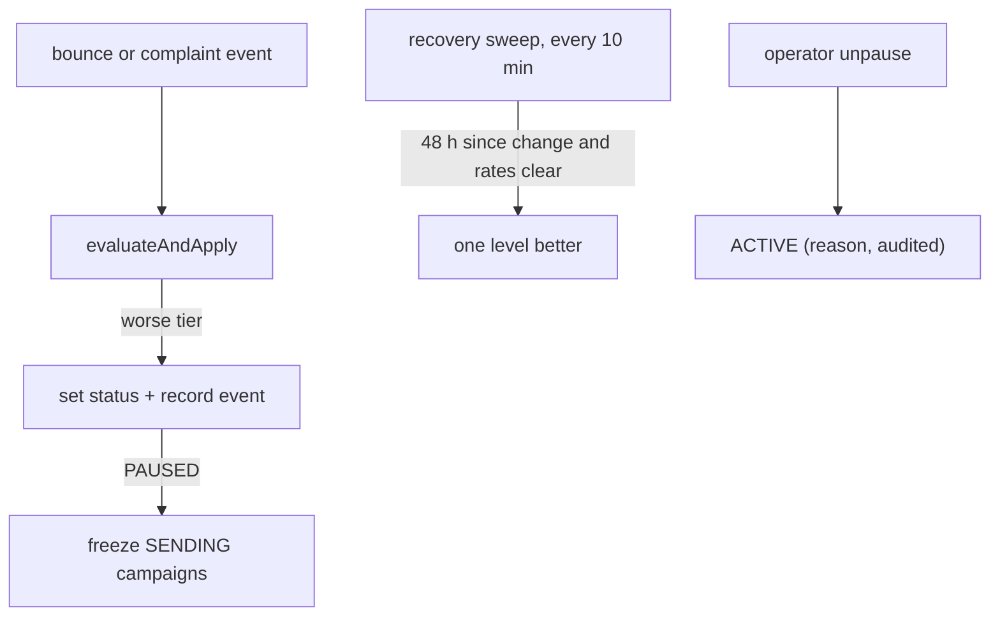

# Deliverability and reputation

All tenants send through one SES account, so one tenant with a bad list can damage everyone's
delivery and put the account under AWS review. The engine therefore watches each tenant's
bounce and complaint rates and acts **before** the mail costs anything
([ADR 0005](adr/0005-reputation-gate-before-cost.md)). Code:
[`reputation.service.ts`](../../apps/api/src/services/reputation.service.ts),
[`mailer.service.ts`](../../apps/api/src/services/mailer.service.ts),
[`jobs/health-sweep.job.ts`](../../apps/api/src/jobs/health-sweep.job.ts).

## 1. The rates

Computed from the database (`email_messages` sent in a rolling **14 days**), so they survive a
Redis flush and work in every mode:

| Rate | Formula | Used for tiering |
| --- | --- | --- |
| Bounce rate | messages with a bounce / messages sent | shown |
| Permanent bounce rate | `Permanent` bounces / messages sent | **yes** |
| Complaint rate | complaints / messages sent | **yes** |

Soft (transient) bounces appear in the bounce rate but do not move the tier. A tenant with
fewer than `EMAIL_REPUTATION_MIN_SENDS` (default 100) sends in the window is always `ACTIVE`, so
one early bounce cannot pause a new domain.

## 2. The tiers

| Status | Permanent bounce rate at or above | Complaint rate at or above |
| --- | --- | --- |
| `WARNING` | 3% (`EMAIL_REPUTATION_BOUNCE_WARN`) | 0.05% (`EMAIL_REPUTATION_COMPLAINT_WARN`) |
| `THROTTLED` | 4% (halfway) | 0.075% (halfway) |
| `PAUSED` | 5% (`EMAIL_REPUTATION_BOUNCE_PAUSE`) | 0.1% (`EMAIL_REPUTATION_COMPLAINT_PAUSE`) |

A tenant's status is the worst tier either rate crosses. The pause thresholds sit at SES's own
review points (5% bounces, 0.1% complaints) on purpose: keep the engine's below AWS's.

What each status does to a message category (a multiplier on the tenant's base TPS):

| Status | `MARKETING` | `NOTIFICATION` | `TRANSACTIONAL` |
| --- | --- | --- | --- |
| `ACTIVE` | full | full | full |
| `WARNING` | 0.5 | full | full |
| `THROTTLED` | 0.1 | 0.5 | full |
| `PAUSED` | **blocked** | 0.5 | full |

Transactional mail (double opt-in confirmations, tests) is never throttled or blocked: a person
asking to subscribe must always get their link.

## 3. Transitions

- **Degrade** happens right after a bounce or complaint is applied. It only moves to a worse
  tier. On `PAUSED`, every `SENDING` campaign of the tenant becomes `PAUSED` with the reason
  `Tenant sending paused`, and the campaign loop and the mailer both refuse marketing sends.
- **Recover**: `WARNING` and `THROTTLED` tenants step up one level per sweep once 48 hours have
  passed since the last change and the current rates would be a better tier.
- **`PAUSED` never recovers by itself.** An operator reviews the tenant, then calls
  `POST /operator/tenants/:id/email/unpause` with a required reason (SUPERADMIN, audited). The
  status goes straight to `ACTIVE`. The paused campaigns stay `PAUSED`: the tenant resumes them
  deliberately.
- Every change is a row in `email_reputation_events` with the trigger, the reason and the rates,
  shown on the tenant's Reputation page and the console's tenant page.

Unpausing a tenant whose list is still bad just lets the next bounces re-pause it once the rates
cross a threshold again. Ask the tenant to clean the list first.

## 4. Quota is the other gate

The plan's monthly emails limit stops a tenant from sending more than it bought, whatever its
reputation ([sending-pipeline.md](sending-pipeline.md#quota)).

## 5. Account level

The console's **Account health** page reads SES `GetAccount`: whether sending is enabled, whether
the account is still in the **sandbox**, the 24-hour quota and maximum send rate, and the
account-wide 14-day bounce and complaint rates from the engine's own events. In simulated mode
it shows a fixed plausible account (`mode: simulated`). Terraform adds CloudWatch alarms on the
SES account bounce and complaint rates ([deploy-aws.md](../guides/deploy-aws.md#7-alarms)).

## 6. Domain health

`verify-domains` (every minute) refreshes pending domains; `health-sweep` (daily, live SES only)
re-checks verified ones: DKIM and MAIL FROM from SES, SPF and DMARC by DNS. It records a row in
`email_domain_health_checks`. A domain that is broken in two checks more than 24 hours apart is
set `FAILED`, the resolver cache is cleared, and campaigns on it pause on their next batch
(`Sender or domain not verified`).

A new domain is `FAILED` only 24 hours after creation if SES still reports a failure, so slow
DNS propagation does not fail it early.

## 7. What tenants can do to stay healthy

- Authenticate the domain fully (DKIM, MAIL FROM, SPF), publish a DMARC policy, start with a
  small engaged segment and grow ([connect-ses.md](../guides/connect-ses.md#7-warm-up)).
- Never import purchased or old lists; the import asks for confirmation of permission.
- Use double opt-in on public forms.
- Watch the Reputation page; act on `WARNING`.

## 8. Limitations

- The tiers use bounce and complaint **rates**; they do not look at spam-trap hits, blocklists or
  inbox placement, which SES does not report per message.
- One shared SES account: a tenant at `WARNING` still shares the account's reputation with the
  rest until it recovers.
- Complaints reach the engine only when the mailbox provider sends feedback to SES (most major
  providers do, some do not).
- Thresholds are deployment-wide environment variables, not per tenant.
