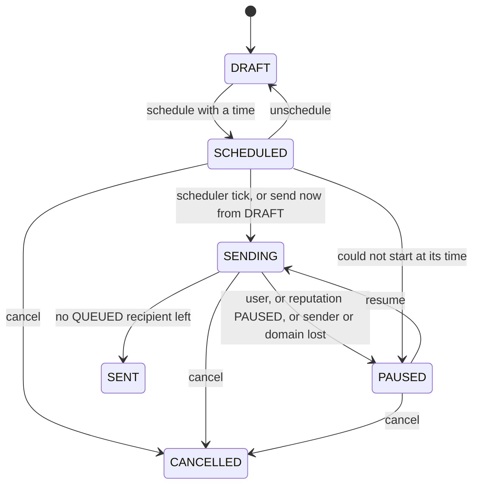

# The sending pipeline

From a click on "Send" to a message at SES, and back again as events. Code:
[`campaigns.service.ts`](../../apps/api/src/services/campaigns.service.ts),
[`campaign-sender.service.ts`](../../apps/api/src/services/campaign-sender.service.ts),
[`mailer.service.ts`](../../apps/api/src/services/mailer.service.ts),
[`email-ses.client.ts`](../../apps/api/src/services/email-ses.client.ts),
[`utils/render.ts`](../../apps/api/src/utils/render.ts).

## 1. Campaign states

| Rule | Detail |
| --- | --- |
| Edit | Only a `DRAFT`. Unschedule or duplicate first |
| Delete | Only `DRAFT` or `CANCELLED` |
| Schedule | From `DRAFT` or `SCHEDULED`; `at` must be a future ISO-8601 instant, at most 366 days away. No `at` means send now. The preflight must have no error |
| Pause | Only `SENDING` (reason "Paused by a user") |
| Resume | Only `PAUSED`; refused (422) if the sender's domain is unverified or sending is `PAUSED` |
| Cancel | `SCHEDULED`, `SENDING` or `PAUSED`; queued recipients become `SKIPPED` with `CAMPAIGN_CANCELLED` |
| `FAILED` | Exists in the enum; 0.1 does not set it. A recipient fails, the campaign does not |

`paused_reason` says why: `Paused by a user`, `Tenant sending paused`, `Sender or domain not
verified`, or the message of the error that stopped a scheduled start.

## 2. Preflight

`GET /campaigns/:id/preflight` and, inside `schedule`, the same checks. Errors block, warnings
inform.

| Code | Severity | Meaning |
| --- | --- | --- |
| `NO_SUBJECT`, `NO_CONTENT` | error | Nothing to send |
| `NO_SENDER` | error | No sender chosen |
| `DOMAIN_NOT_VERIFIED` | error | The sender is archived or its domain is not `VERIFIED` |
| `SENDING_PAUSED` | error | Reputation status is `PAUSED` |
| `AUDIENCE_INVALID` | error | The chosen list or segment no longer exists |
| `NO_RECIPIENTS` | error | Everyone matched would be skipped |
| `QUOTA_EXCEEDED` | error | More sendable recipients than the month has left |
| `SENDING_THROTTLED`, `SENDING_WARNING` | warning | Reputation is degraded |
| `NO_UNSUBSCRIBE_TAG` | warning | No `{{unsubscribe_url}}`; a footer with one is added |
| `NO_COMPANY_ADDRESS` | warning | Set the postal address in Settings |
| `NO_LINKS` | warning | No static links, so no click tracking |

The response also returns `recipients` (sendable), `suppressed` (skipped) and `quotaRemaining`.

## 3. Starting: the audience snapshot

`start` runs in one transaction: it locks the campaign row, writes the recipients with one
`INSERT ... SELECT` from `contacts`, then sets `SENDING` and enqueues a `campaign` job. The
snapshot is deduplicated by contact (`unique(campaign_id, contact_id)`, conflicts ignored) and
each row is `QUEUED` or `SKIPPED` with a reason evaluated in SQL:

| `skip_reason` | When |
| --- | --- |
| `UNSUBSCRIBED`, `BOUNCED`, `COMPLAINED`, `PENDING_CONFIRMATION` | The contact's status |
| `SUPPRESSED` | An `email_suppressions` row with scope null or `MARKETING` |

Audiences are `ALL`, `LISTS` (a contact counts when it is a `subscribed` member of any chosen
list) or `SEGMENT` (the rules are evaluated now, [audience-and-segments.md](audience-and-segments.md)).
The segment is **not** re-evaluated later, so the snapshot is fixed at start.

### Quota

Before the status changes, the number of `QUEUED` rows must fit what is left of the month, else
the transaction aborts with 422 and nothing is written. The authoritative gate is per message:
the mailer reserves one unit per send, so a campaign that started with room but shares the
month with another can still stop part way; the rest become `SKIPPED` with `OVER_QUOTA`. Test
sends do not count.

## 4. Sending: the worker loop

`CampaignSender.run(id)` works for at most 25 seconds, then re-enqueues itself. Each pass:

1. Stop if the campaign is no longer `SENDING`.
2. If the tenant is `PAUSED`, pause the campaign (`Tenant sending paused`) and stop.
3. Resolve the sender; if its domain is no longer verified, pause (`Sender or domain not
   verified`) and stop.
4. **Claim** up to `EMAIL_SEND_BATCH` (default 50) `QUEUED` recipients with `FOR UPDATE SKIP
   LOCKED`, stamping `claimed_at`. A claim older than 5 minutes is taken over, so a crashed
   worker loses nothing. Parallel workers never share rows.
5. For each recipient, re-read the contact; one that is no longer `SUBSCRIBED` is skipped.
6. Call the mailer ([section 5](#5-one-message)).
7. Map the result: `sent` and `duplicate` mark the recipient `SENT` (never downgrading a
   status the simulator or an SES event already set), `suppressed` and `quota` skip with
   `SUPPRESSED` and `OVER_QUOTA`, `failed` marks `FAILED`, `gated` pauses the campaign,
   `rate_limited` releases the claim for later.
8. With no batch left and nothing `QUEUED`, set `SENT` and `completed_at`. If rows are claimed by
   another worker, look again in 5 seconds.

The scheduler tick every 30 seconds also re-enqueues every `SENDING` campaign, so a lost job is
picked up.

## 5. One message

`MailerService.sendTenant`, in order. Cheap checks come before anything that costs money.

| Step | Outcome on failure |
| --- | --- |
| Reputation gate: the category multiplier must be above zero | `gated` |
| Suppression check for this address and category | `suppressed` |
| Wait up to 15 seconds for a send slot (per tenant and account-wide) | `rate_limited` |
| Reserve one unit of the monthly quota (campaign and confirmation mail; not tests) | `quota` |
| Insert the `email_messages` row with the idempotency key `campaign:<id>:<contactId>` | `duplicate` (the unit is given back) |
| Render the message for this contact | |
| SES `SendEmail` with the tenant's configuration set | `failed` (the unit is given back, the row is marked failed) |
| Mark sent, write the `SEND` event | |
| Simulated mode only: play the outcome through the event handler | |

The idempotency key is why a retried job, a re-enqueued campaign or a resumed one never sends
the same contact twice.

### Rate limits

The send limiter takes two one-second Redis counters and both must pass: the tenant's
(`EMAIL_DEFAULT_TENANT_TPS`, default 5, overridable per tenant by an operator in `tenants.config.emailTps` (capped at the account rate),
scaled by the reputation multiplier, never below 1) and the account's (`EMAIL_ACCOUNT_TPS`,
default 14, SES's maximum send rate). Without Redis, or if Redis errors, the limiter allows the
send: set the TPS values from your SES quota and run Redis in production.

## 6. Rendering

[`render.ts`](../../apps/api/src/utils/render.ts) is a pure function and executes nothing from
the template.

1. **Sanitise** the HTML: `script`, `iframe`, `object`, `embed`, `applet`, `base` and `meta
   http-equiv` are removed, as are `on...` handlers and `javascript:`, `vbscript:` and
   `data:text/html` URLs.
2. **Substitute merge tags** from a fixed table: `first_name`, `last_name`, `full_name`,
   `email`, `company_name`, `company_address`, `unsubscribe_url`, `view_in_browser_url`,
   `current_year`, and `attr.<key>` for custom fields. Syntax: `{{first_name}}` or
   `{{first_name | default: "there"}}`. Values are HTML-escaped. An unknown tag, or one with no
   value and no default, renders empty and is reported in `missingTags`.
3. **Footer**: when the template has no `{{unsubscribe_url}}`, a footer with the company name,
   postal address, view-in-browser and unsubscribe links is appended.
4. **Track links**: each static `http(s)` link that is in `campaign_links` is rewritten to
   `/t/c/<token>`. Links with merge tags in the URL are left alone and are not tracked. The
   unsubscribe and view links are never rewritten.
5. **Preheader**: added as a hidden block at the top of the body.
6. **Open pixel**: a 1x1 image appended before `</body>`.
7. **Text part**: the template's text, or one derived from the HTML, with the unsubscribe URL
   appended.

Headers on every campaign message: `List-Unsubscribe: <https://.../u/<token>>` and
`List-Unsubscribe-Post: List-Unsubscribe=One-Click` (RFC 8058). The subject has line breaks
removed. The SES message carries the tags `tenantId`, `messageId`, `category` and `campaignId`;
the events consumer finds the message through them.

Campaign `html` is a **copy** taken when the campaign is created from a template, so editing a
template later does not change existing campaigns.

## 7. Other mail the engine sends

| Mail | From | Category | Counts toward quota |
| --- | --- | --- | --- |
| Campaign | Chosen sender | `MARKETING` | Yes |
| Double opt-in confirmation | The tenant's default `TRANSACTIONAL` sender | `TRANSACTIONAL` | Yes |
| Campaign test (up to 5 addresses) | The campaign's sender | `TRANSACTIONAL` | No |
| Sender test | The sender | `TRANSACTIONAL` | No |
| Invitations, password resets, operator welcome | `AWS_SES_FROM_EMAIL` | n/a (not tracked) | No |

Tenant mail never falls back to a platform address: if a tenant has no verified domain, nothing
is sent for it.

## 8. Events coming back

[`email-events.service.ts`](../../apps/api/src/services/email-events.service.ts) is the one place
outcomes are applied, for SES events and the simulator alike.

| Event | Effect |
| --- | --- |
| `DELIVERY` | Message delivered; recipient `DELIVERED`; contact `emails_received` +1 |
| `BOUNCE` Permanent | Message bounced; recipient `BOUNCED`; contact `BOUNCED` (unless already `COMPLAINED`); suppression `HARD_BOUNCE`; reputation evaluated |
| `BOUNCE` Transient or Undetermined | Message bounced (counts in rates), nothing else changes |
| `COMPLAINT` | Message complained; contact `COMPLAINED`; suppression `COMPLAINT`; reputation evaluated |
| `REJECT` | Message rejected; recipient `FAILED` |
| `SEND`, delivery delay, SES `OPEN` and `CLICK` | Ignored: the engine's own pixel and redirect are the source of engagement |

Every event is idempotent: a unique index on `(message, type)` drops a replay before any side
effect runs, because SQS delivers at least once. An event whose message tags are missing, or
whose message is unknown, is logged and dropped.

## 9. Limitations

- One recipient per SES call; there is no bulk templated send.
- Links whose URL contains a merge tag are not click tracked.
- A campaign's HTML is limited to 500,000 characters.
- No send-time optimisation, no throttling by receiving domain.
